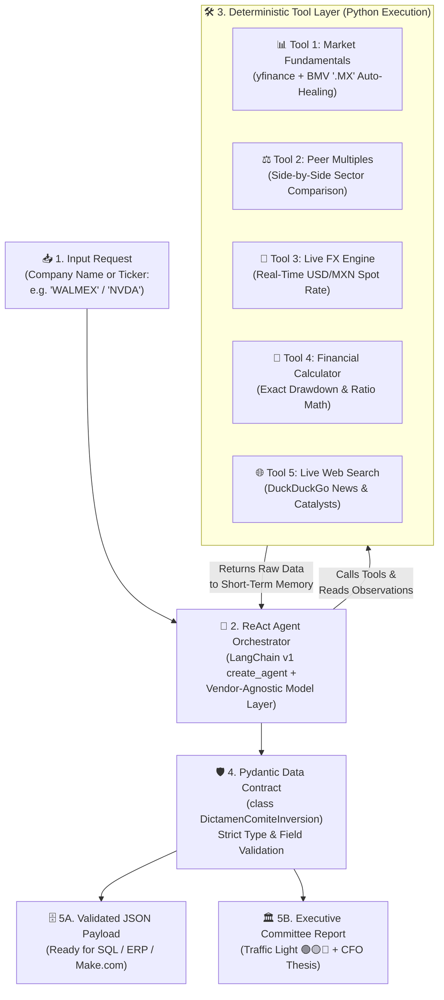

# 🏛️ Executive Architecture Specification: Autonomous Financial & Counterparty Due Diligence Agent (`v2.0`)

**Author:** Steven — AI Systems Architect  
**Framework:** LangChain v1 (`create_agent`) + Pydantic Data Contracts (`ToolStrategy`)  
**Target Use Case:** Automated Investment Committee Tear-Sheets & Counterparty Financial Due Diligence  

---

## 1. Executive Summary & Business Case

Financial analysts and credit committees spend hours manually gathering valuation multiples, converting currencies across markets (`MXN` vs. `USD`), benchmarking sector competitors, calculating drawdown ratios in spreadsheets, and scanning news portals for regulatory or operational catalysts.

| Metric | Manual Analyst Baseline | Autonomous Agent (`v2.0`) | Business Impact |
| :--- | :--- | :--- | :--- |
| **Turnaround Time** | 2.5 – 4.0 hours per company | **18 – 25 seconds** | **99% latency reduction** |
| **Arithmetic Accuracy** | Prone to Excel formula/copy errors | **100% Deterministic (Python `eval`)** | Zero hallucinated financial ratios |
| **Data Structure** | Unstructured PDF/Word memos | **Validated `Pydantic` JSON Contract** | Direct ingestion into SQL / ERP / BI |
| **Vendor Lock-in** | Tied to a single SaaS license | **Vendor-Agnostic (`init_chat_model`)** | Swap Gemini, OpenAI, or Claude in 1 line |

---

## 2. System Architecture Diagram

---

## 3. Deterministic Tool Specifications

| # | Tool Name | Input Schema | Deterministic Source / Engine | Business Purpose |
| :--- | :--- | :--- | :--- | :--- |
| **1** | `obtener_fundamentales_bolsa` | `ticker: str` | Yahoo Finance API (`yfinance`) + `BMV_TICKER_MAP` | Retrieves live price, 52-week range, Market Cap, P/E, Net Margin, ROE, and Debt/Equity with automatic `.MX` ticker healing. |
| **2** | `comparar_competidores_sector` | `tickers_separados_por_coma: str` | Yahoo Finance API (`yfinance`) | Benchmarks 2–4 direct competitors side by side (Trailing P/E, Forward P/E, Net Margin, ROE). |
| **3** | `tipo_cambio_usd_mxn_en_vivo` | `monto: float, direccion: str` | Live Spot FX (`MXN=X`) | Converts Market Cap and financial figures between `MXN` and `USD` using real-time spot rates. |
| **4** | `calculadora_financiera` | `expresion_matematica: str` | Isolated Python Math Engine | Executes exact arithmetic (52-week drawdown %, valuation ratios) so the LLM never estimates math. |
| **5** | `busqueda_web_tiempo_real` | `consulta: str` | DuckDuckGo Live Search (`ddgs`) | Breaks the LLM's training cutoff to capture quarterly earnings, regulatory actions (COFECE/SAT), and recent IPOs. |

---

## 4. Data Contract Specification (`Pydantic`)

Every execution must pass validation against `class DictamenComiteInversion(BaseModel)` before leaving the agent loop:

* `empresa` (`str`): Official legal entity name.
* `ticker` (`str`): Normalized exchange symbol.
* `precio_actual_moneda` (`str`): Spot price with ISO currency code.
* `descuento_max_52s_pct` (`float`): Python-calculated percentage distance from 52-week high.
* `pe_trailing` (`float`) & `roe_pct` (`float`): Core valuation and profitability metrics.
* `valor_mercado_usd_billones` (`float`): Market capitalization standardized in Billions USD.
* `comparativa_competidores` (`list[str]`): Structured peer valuation benchmarks.
* `catalizadores_recientes` (`list[str]`): Top 3 verified news catalysts.
* `semaforo_comite` (`str`): Institutional risk rating (`🟢 VERDE - SÓLIDA` | `🟡 AMARILLO - CAUTELA` | `🔴 ROJO - RIESGO ALTO`).
* `tesis_ejecutiva` (`str`): Quantitative 3-line CFO investment thesis.

---

## 5. Production Guardrails & Error Handling

1. **Input Self-Healing:** Automatic mapping of colloquial Mexican corporate names (e.g., `"Bimbo"`, `"Walmex"`, `"Chedraui"`, `"Banorte"`) to official Bolsa Mexicana de Valores tickers (`.MX`).
2. **API Cost & Rate-Limit Control:** System prompt constraints cap external web searches to a single call per company (`Num Tools <= 5`), preventing runaway ReAct loops.
3. **Graceful Degradation:** All 5 tools execute inside defensive `try/except` blocks, returning structured error diagnostics to the agent rather than crashing the pipeline.
